<div align="center">

# plants store

### A calm, plant-first Flutter storefront experience

An asset-backed mobile UI prototype for browsing indoor plants, viewing a product, managing a sample cart, and following a demonstration delivery flow.

[](https://flutter.dev)
[](https://dart.dev)


</div>

## Overview

`plants_store` is a Flutter mobile interface centred on indoor-plant discovery. It opens with a short branded splash screen, moves through a welcome and sign-in/sign-up flow, and then presents a curated plant storefront. The experience uses a soft mint palette, deep green controls, plant photography, rounded cards, and a persistent four-item navigation bar.

All catalogue, profile, promotion, order, and delivery information is local demonstration content. The project does not connect to authentication, a backend, payments, maps, or persistent storage.

## Key Features

- **Branded entry flow:** A two-second splash screen transitions to a welcome page with routes to the login and sign-up forms.
- **Demonstration account screens:** Login and sign-up provide local form UI; the sign-up "Remember me" switch is interactive, while form submission only navigates between screens and does not authenticate or save credentials.
- **Plant discovery:** The discover screen presents horizontally scrolling categories, a promotional card, and a best-seller carousel using bundled images and static product data.
- **Indoor search results:** The search control routes to a scrollable two-column indoor catalogue with plant names, prices, ratings, and locally toggled favourite icons.
- **Product detail and cart flow:** A Fiddle Leaf Fig detail page leads to a sample cart. Quantity controls update the in-memory subtotal, discount display, delivery fee, and total for the two fixed cart items.
- **Favourites empty state:** A dedicated empty-state screen links visitors back to discovery. Favourite selections in listing cards are visual, per-card state and are not persisted to this screen.
- **Delivery demonstration:** Static order progress, delivery details, courier actions, and a map-style tracking view illustrate the post-checkout journey.
- **Profile navigation:** A local account screen groups example order, transaction, wishlist, settings, and help entries; its logout action routes to the login screen.

## Screenshots

<table>
  <tr>
    <td align="center">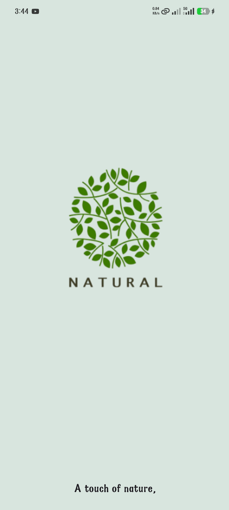<br><strong>Splash Screen</strong></td>
    <td align="center">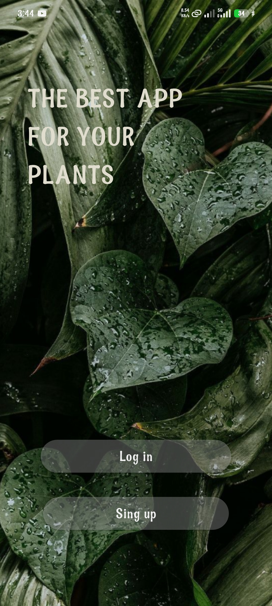<br><strong>Welcome</strong></td>
    <td align="center">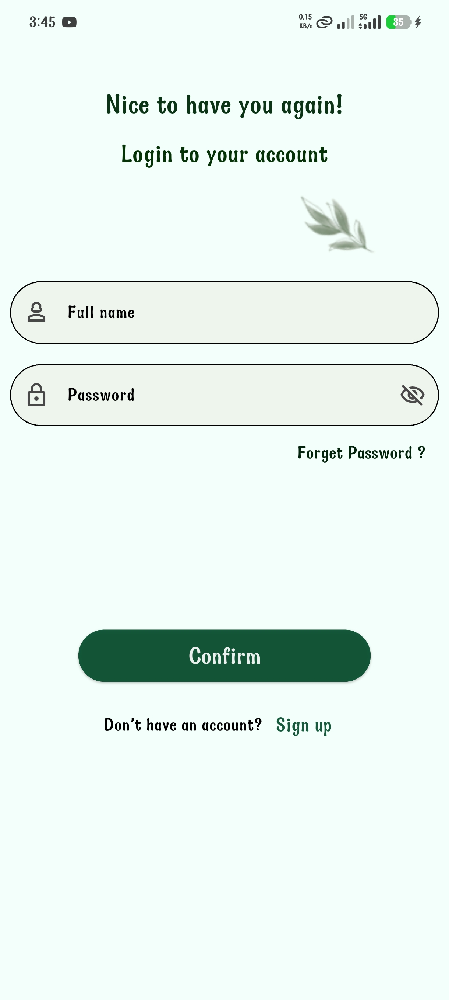<br><strong>Login</strong></td>
  </tr>
  <tr>
    <td align="center">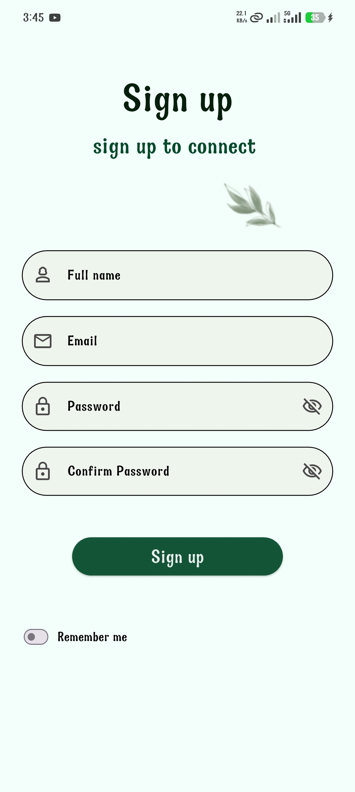<br><strong>Sign Up</strong></td>
    <td align="center">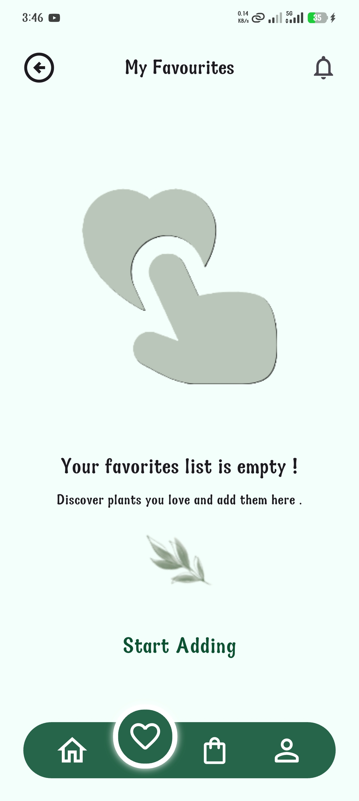<br><strong>Favourites</strong></td>
    <td align="center">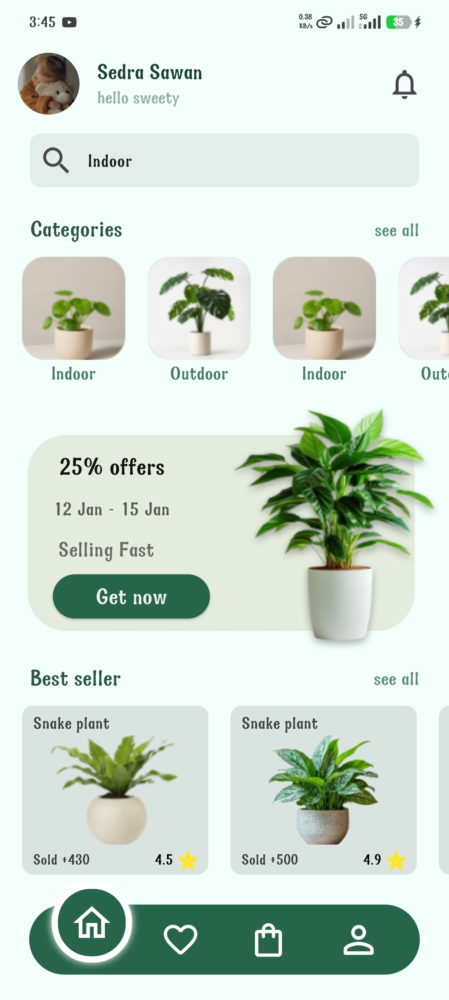<br><strong>Discover</strong></td>
  </tr>
  <tr>
    <td align="center">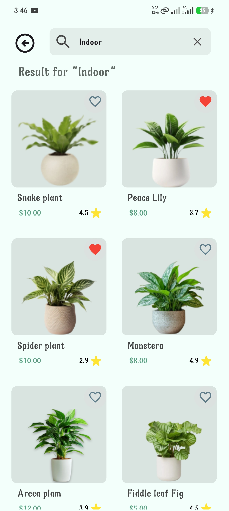<br><strong>Indoor Results</strong></td>
    <td align="center">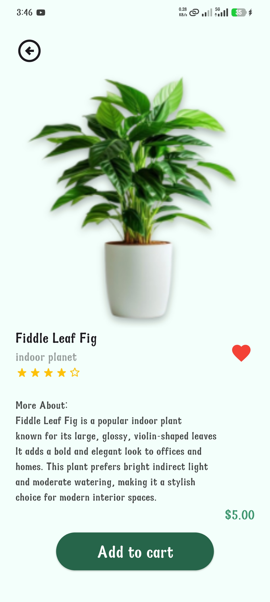<br><strong>Product Detail</strong></td>
    <td align="center">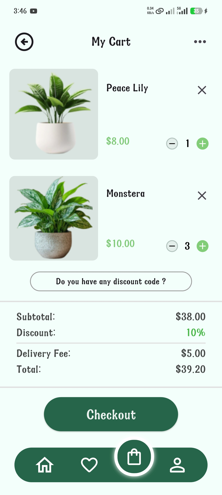<br><strong>Cart</strong></td>
  </tr>
  <tr>
    <td align="center">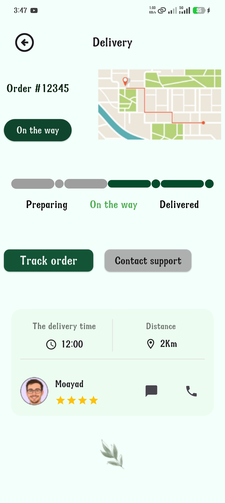<br><strong>Delivery Status</strong></td>
    <td align="center">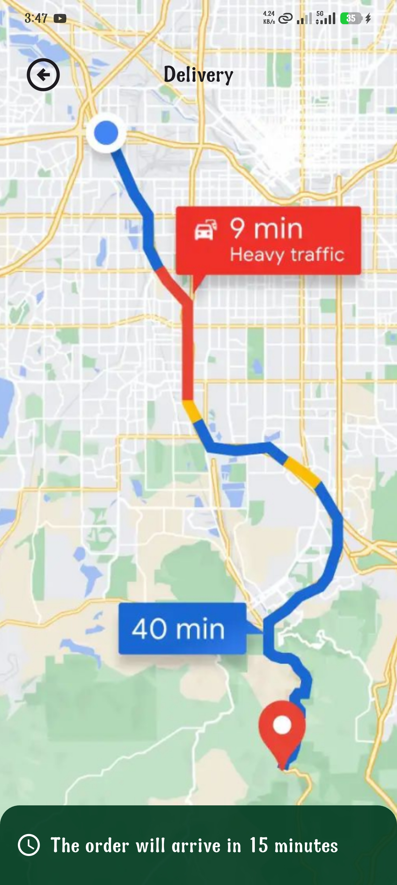<br><strong>Tracking View</strong></td>
    <td align="center">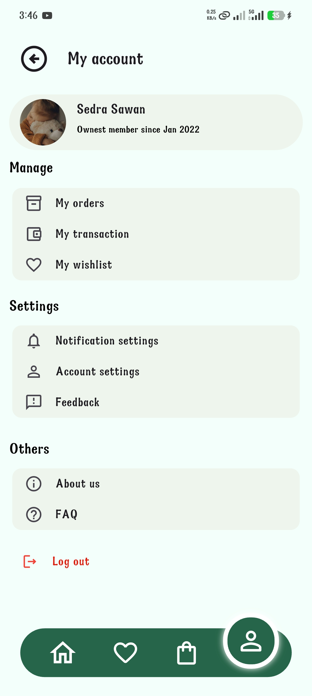<br><strong>Profile</strong></td>
  </tr>
</table>

## Technology Stack

| Technology | Role in the project |
| --- | --- |
| Flutter | Mobile UI framework and application runtime. |
| Dart | Application language; the project declares SDK constraint `^3.9.2`. |
| Material widgets | Scaffolds, app bars, forms, buttons, cards, lists, icons, and navigation UI. |
| Named routes | Screen-to-screen navigation registered in `main.dart`, with `Navigator` used by shared controls. |
| Local widget state | `StatefulWidget` and `setState` handle cart quantities, favourite icons, the sign-up switch, and input focus state. |
| Bundled image assets | Local images in `images/` supply the storefront, product, profile, and map visuals. |

`cupertino_icons` is the only declared runtime package. `flutter_launcher_icons` is configured as a development dependency for launcher-icon generation; it is not used by the running UI.

## Project Structure

```text
plants_store/
|-- lib/
|   |-- main.dart                 # App entry point and named route registry
|   |-- welcome.dart              # Timed splash screen
|   |-- homepage.dart             # Welcome screen and account entry actions
|   |-- login.dart                # Login form UI
|   |-- signup.dart               # Sign-up form UI and local switch state
|   |-- discover.dart             # Storefront discovery screen
|   |-- indoor.dart               # Indoor plant results grid
|   |-- buy.dart                  # Fiddle Leaf Fig detail screen
|   |-- cart.dart                 # Sample cart and calculated totals
|   |-- delivery.dart             # Delivery status summary
|   |-- delivery2.dart            # Map-style tracking screen
|   |-- favourits.dart            # Favourites empty state
|   |-- profile.dart              # Account overview
|   `-- shared/                   # Reusable app bar, navigation, cards, inputs, and sizing helpers
|-- images/                       # Declared Flutter image assets
|-- Screenshots/                  # README screen captures
|-- pubspec.yaml                  # Package and asset configuration
`-- README.md
```

## Getting Started

### Prerequisites

- Flutter SDK compatible with the project's Dart SDK constraint (`^3.9.2`)
- An Android emulator, iOS simulator, or compatible physical device
- Android Studio or Visual Studio Code with Flutter tooling (recommended)

### Installation

```bash
git clone https://github.com/USERNAME/plants-store.git
cd plants_store
flutter pub get
flutter run
```

Replace `<YOUR_REPOSITORY_URL>` with the repository URL. No environment variables, API keys, or external-service configuration are required by the current codebase.

## Implementation Notes

- **Composition:** Each screen is a focused Flutter widget assembled from standard Material components and local image assets. `ScreenSize`, a `BuildContext` extension, provides dimensions from `MediaQuery` for the existing proportional layouts.
- **Reusable UI:** `AppBarS`, `NavBarS`, `Batten1`, `PContainer`, `TexTFind`, `SearchS`, and `CounterS` centralize repeated visual patterns and navigation affordances.
- **Navigation:** `Plants` configures the named routes in `main.dart`. Buttons and the bottom navigation call `Navigator.pushNamed`; the splash uses `pushReplacement` to enter the welcome screen.
- **State and data:** There is no external state-management library or data repository. Screen state remains local to widgets: counters feed cart arithmetic, hearts toggle in each `PContainer`, the sign-up switch updates locally, and search focus changes the field styling. Product, order, and profile values are hard-coded presentation data.

## Future Improvements

- Replace static catalogue and account data with a validated domain model and repository layer.
- Add real authentication, input validation, and secure session handling.
- Persist favourites and cart contents across screens and app sessions.
- Connect checkout and delivery views to real order, payment, mapping, and support services.

## Author

https://github.com/Jawadsandouk

## License

No license file is currently included in this repository.
